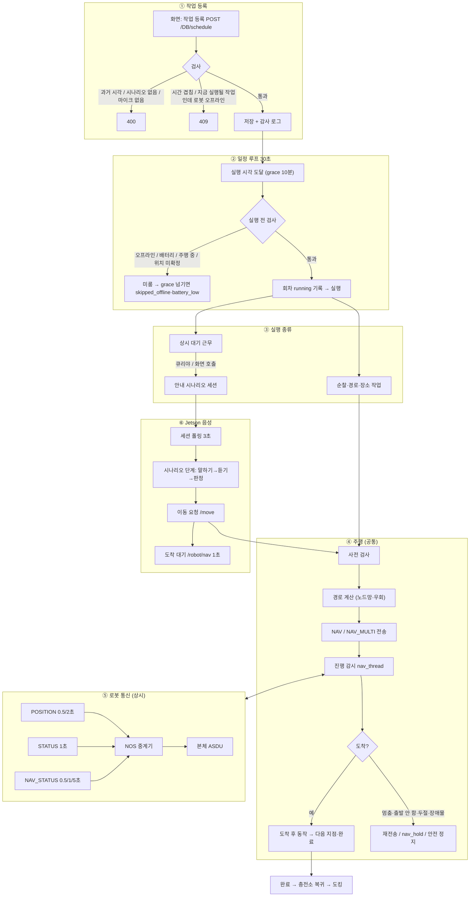
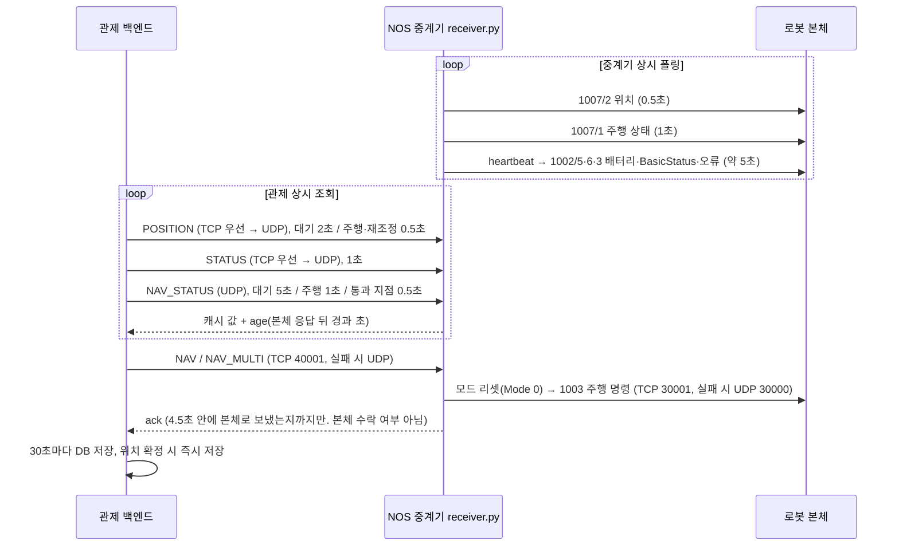
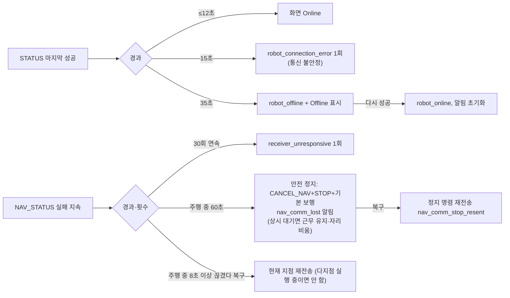
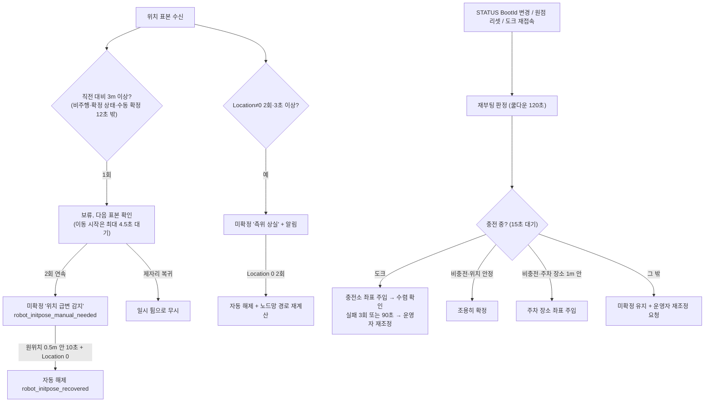
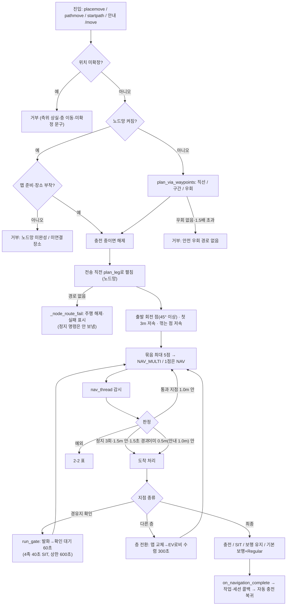
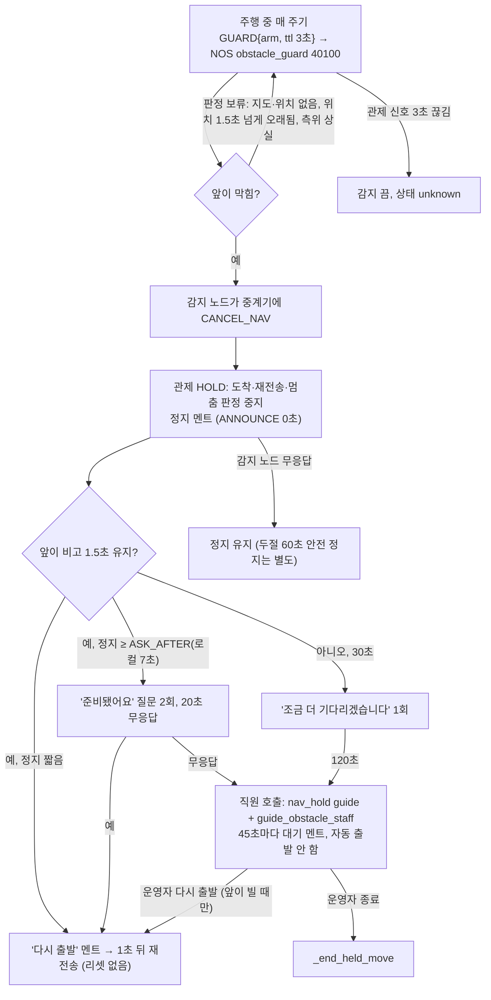
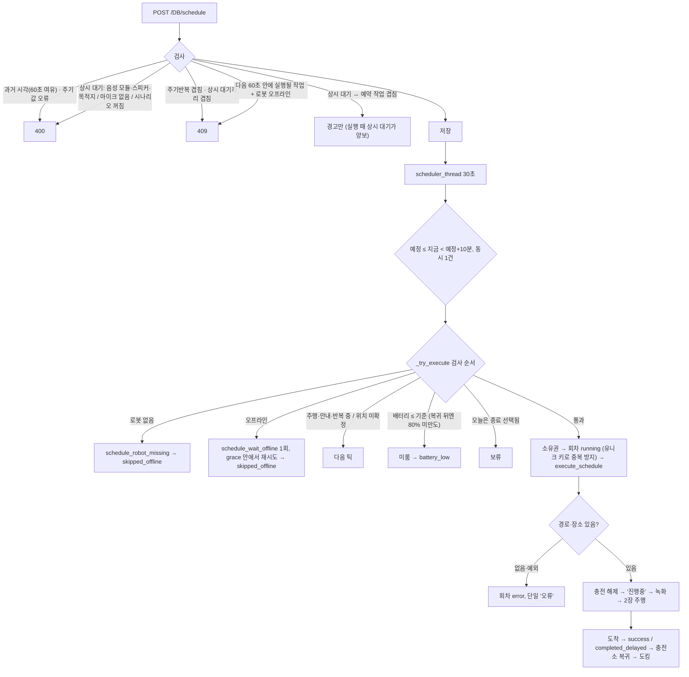
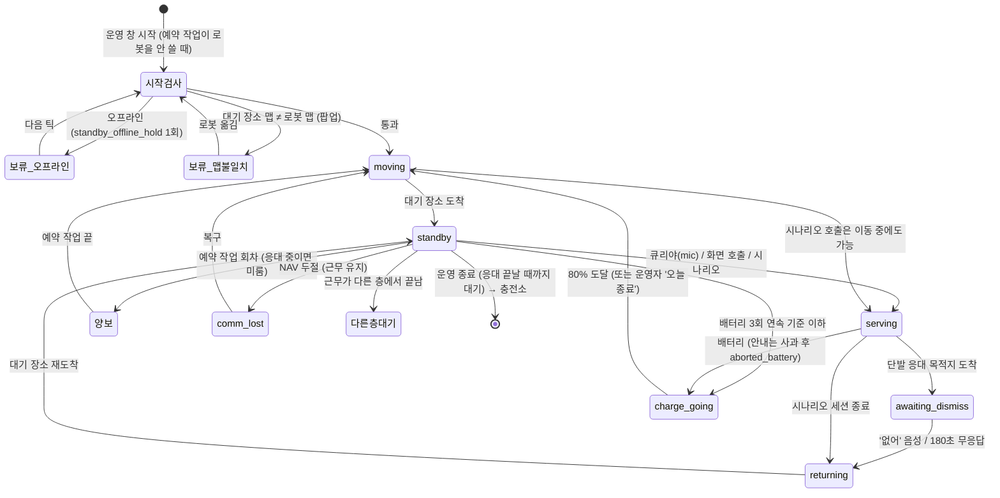
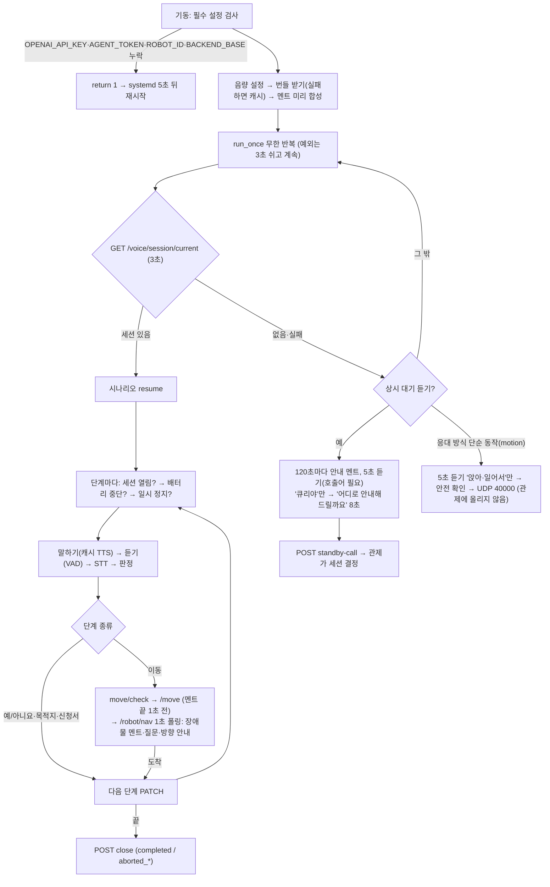

# 07. 핵심 동작 흐름과 예외 처리

- 작성일 2026-11-26. 원자료: 2026-11-06 코드 조사(`Backend/app`, `robot_receiver`, `robot_voice`; 줄 번호는 그날 기준이라 이후 코드가 바뀌었으면 어긋날 수 있음).
- 경로 표기: `Backend/app/` 아래는 앞부분을 생략했습니다(예: `robot_io/polling.py`). 나머지는 저장소 최상위 기준.
- 그림은 mermaid 문법입니다(VS Code 미리보기 확장, GitHub, Obsidian 에서 그림으로 보임).
- 한계: 코드에 적힌 동작만 다룹니다. 본체·NOS **제조사 쪽 실제 동작**과 운영 설정값은 확인하지 않았고, 모르는 것은 "추정"으로 표시했습니다.

## 0. 전체 그림

---

## 1. 로봇 통신 (관제 ↔ NOS 중계기 ↔ 본체)

### 1-1. 정상 흐름

- 근거: 주기 `robot_io/config.py:55-56`, `robot_io/polling.py:336-342,669,1443-1448`, `robot_receiver/receiver.py:52,84-138,141-299` / 전송 `robot_io/sender.py:74-108,216-250`, `robot_receiver/receiver.py:541-553,576,1347-1361` / 저장 `robot_io/persistence.py:15,139-198`
- 통신 대상 주소는 전역 `RECEIVER_IP`/`ROBOT_IP` 하나라서 **지금 구조는 로봇 1대를 전제**합니다(`robot_io/polling.py:380-389`, `robot_io/sender.py:95-96`).

### 1-2. 통신 두절 판정 (시계 세 개)

### 1-3. 예외 표

| 상황 | 감지 기준 | 처리 | 근거 |
|---|---|---|---|
| POSITION TCP 실패 또는 구버전 응답 | 연결·수신 예외, `timestamp` 없음 | 쌓인 옛 답(최대 64개)을 버리고 UDP 로 1회 다시 묻습니다(2초). 실패하면 그 주기를 건너뜁니다 | `robot_io/polling.py:345-362,385-416` |
| 늦게 온 옛 UDP 위치 답 | 중계기 `timestamp` 가 직전 채택값보다 작음 | 버립니다. 3회 연속이면 기준을 다시 잡습니다 | `robot_io/polling.py:212-233` |
| 오래된 위치 | `age` > 3초 | 좌표는 반영하되 급변·측위 판정에는 쓰지 않습니다 | `robot_io/polling.py:315-333` |
| STATUS 원천값이 오래됨 | 중계기 BasicStatus 시각이 관제 시각보다 8초 이상 늦음 | 실패로 처리, 처음 감지할 때 `mark_offline`. ※ 두 장비의 시계를 직접 비교하므로 시계가 어긋나면 오판할 수 있음(추정) | `robot_io/polling.py:555-575` |
| 통신 불안정 / 오프라인 | 위 그림 1-2 | 15초에 알림 1회, 35초에 오프라인 확정. ※ 코드 주석의 "10초·12초"는 옛 값 | `robot_io/polling.py:455-456,637-667`, `robot_io/runtime.py:18-19,489-512` |
| NAV ACK 없음(단일) | TCP 5초/6초 실패 → UDP 2초 무응답 | 로그만 남깁니다("명령 유실 가능"). 호출한 쪽에 실패를 알리지 않으므로 실제 복구는 1-4/2-2 의 출발 미감지 재전송이 맡습니다 | `robot_io/sender.py:148-199` |
| ACK 가 늦음(보행 전환 대기) | 중계기가 4.5초 안에 본체로 보내지 못함 | 중계기는 `ack:false` 를 먼저 돌려주고 명령은 나중에 보냅니다. 다지점은 `n` 이 있으면 수락으로 봅니다 | `robot_receiver/receiver.py:575-576,1181-1183`, `robot_io/sender.py:201-213` |
| 다지점 거절·무응답 | `ack` false 이고 `n` 없음 / `error`(형식 오류, `too_large`) | 그 구간만 단일 NAV 로 보내고 `nav_multi_unsupported` 를 남깁니다. 다음 묶음은 다시 다지점으로 시도 | `navigation/send_move.py:2011-2016` |
| 중계기 → 본체 TCP 실패 | 30001 예외(3초) | UDP 30000 으로 보냅니다. 본체 수락은 확인하지 않음 | `robot_receiver/receiver.py:541-553,795-799` |
| NAV 대기 중 새 명령 | seq 불일치(새 NAV, STOP, CANCEL_NAV, SIT, 수동 이동) | 앞 명령을 버립니다(ack false) | `robot_receiver/receiver.py:597-598,648-650,1284-1286` |
| 보행 전환 확인 실패 | 12초 안에 0x1001 을 보지 못함 | 그대로 NAV 를 보냅니다(로그만) | `robot_receiver/receiver.py:574,646-659` |
| 다지점 크기 초과 | 묶음 바이트 > 976 또는 64점 초과 | `{"ack":false,"error":…}` 로 거절 | `robot_receiver/receiver.py:808-844,1175-1178` |
| 본체 무응답(중계기 쪽) | 각 UDP 1초 무응답 | 마지막 캐시를 유지하고 경과를 `age`/`receiver_age` 로 알림 | `robot_receiver/receiver.py:133-136,401-410,1043-1046` |
| 지원하지 않는 명령 | UDP: 분류에 없음 / TCP: 5종 외 | UDP 는 응답하지 않고, TCP 는 `unsupported action` | `robot_receiver/receiver.py:1295-1296,1364-1369` |
| 맵 데이터 요청 밀림 | 대기 2건 이상, relay_map 1초 무응답 | `{}` 를 돌려줌 | `robot_receiver/receiver.py:1087-1099` |

### 1-4. 위치 급변·측위 상실·재부팅

- 근거: 급변 `robot_io/polling.py:49,86-209` / 상실 `robot_io/polling.py:236-304` / 재부팅 `robot_control/auto_init_pose.py:134-243,286-401,617-698,806-935`, `robot_receiver/receiver.py:1027-1046`
- 수동 재조정(`/robot/initpose`): TCP 먼저, 실패하면 UDP. 성공하면 최대 6초 안에 수렴하는지 확인한 뒤 해제. 층 이동이 사유였으면 자동 해제하지 않음(`robot_control/status.py:236-357`, `robot_control/auto_init_pose.py:1083-1148`).
- 측위가 회복되지 않으면 운영자가 "완료"로 지금 위치를 확정합니다(5초 안에 들어온 위치 + Location 0). 확정 뒤 12초는 급변 검사를 쉼(`robot_control/auto_init_pose.py:1053-1080`).
- **자동 재측위**(`AUTO_RELOCALIZE_ENABLED`): 미확정·제자리일 때 관제가 라이다 스캔을 지도 전체와 맞춰 위치를 넣음(확정은 운영자 "완료"). 맵47 실측 6곳 30/30 정확, 틀린 곳 0(11-06). 실기 미확인.

---

## 2. 주행 (이동 명령 → 경로 → 주행 → 도착)

### 2-1. 정상 흐름과 분기

- 근거: `navigation/send_move.py:37-67,1521-1632,1692-1714,1717-2031,2119-2190`, `navigation/node_route.py:400-472,580-630`, `navigation/via_route.py:388-459`, `robot_io/polling.py:1069-1126,1401-1437,1488-1517`, `navigation/arrival_gate.py:177-253`, `navigation/floor_transition.py:60-200`
- 2026-11-06 기준 운영 스위치(로컬 `.env`): `NODE_ROUTING_ENABLED=true`, `NODE_NAV_MODE=auto`, `NAV_MULTIPOINT_ENABLED=true`, `OBSTACLE_GUARD_MODE=on`, `NAV_KEEP_GAIT_ON_ARRIVAL=true`. 코드 기본값은 모두 꺼짐(`robot_io/config.py:148,180,217-251`). 컨테이너 안 실제 값은 확인하지 않음.
- **노드망 주행 요점:** 장소는 간선 위 점으로 붙고(`간선 우선`), 겹친 간선은 저장 거부, 중계기가 최대 5점으로 압축. 가장 가까운 노드에 붙여 간선 옆 목적지를 지나치던 문제는 끝 노드 자르기(`_trim_ends`)·2m 안 노드가 없어도 간선 옆이면 붙이기로 수정(10-27~28). 갈 길 없는 장소·미연결 장소는 이동 거부.
- **꺾임은 모두 서서 돕니다**(걸으며 도는 설정은 45°로 써 보다 되돌림 — 재제안 금지). 직선 모드(`NODE_NAV_MODE=straight`)는 NOS 계획기가 회전 뒤 0→1.2m/s 계단 가속을 해 앞바퀴가 들린 적이 있어(10-29) `NAV_TURN_SLOW_DEG` 로 회전 뒤 저속을 줍니다. 현재 운영값은 `auto`(자율).

### 2-2. 주행 예외 표

| 상황 | 감지 기준 | 처리 | 근거 |
|---|---|---|---|
| 출발 미감지(짧음) | 움직인 적 없음, 0이 3회, 전송 뒤 15초, 목표에서 멂 | 재전송(재시도 +1) | `robot_io/polling.py:691,1128-1136` |
| 출발 미감지(김) | 전송 뒤 30초 동안 움직이지 않음, 충전 중 아님 | 재전송 | `robot_io/polling.py:684,1206-1217` |
| 재전송 한도 | 지점마다 3회(출발 미감지·255·멈춤·두절 복구 재전송 합산) | 안내·사전 주행: "못 감" 표시와 `nav_hang_skip`. 그 밖: `nav_hold`(운영자 선택) | `robot_io/polling.py:690,1137-1154` |
| 일시정지 상태 255 | status 255 | 5초마다 STAND, 10초 이어지면 재전송(충전 중 제외) | `robot_io/polling.py:1175-1204` |
| 주행 멈춤(hang) | 움직인 뒤 60초 동안 0.2m 미만(확인 대기·층 전환 중 제외) | 일반: 재전송 3회 뒤 `nav_hold`. 안내: 재전송 없이 바로 `nav_hold('guide')` 와 `guide_nav_blocked`. 다시 움직이면 자동 해제 | `robot_io/polling.py:688,744-758,1219-1322` |
| 섰는데 목표에서 멂 | 0이 3회, 거리 1.5m 초과 | 도착이 아니므로 출발 미감지 경로로 넘김 | `robot_io/polling.py:1072-1078` |
| 묶음 끝 도착 놓침 | 마지막 점으로 가는 중이라는 보고 뒤 끝점 0.5m 안 | 도착으로 처리 | `robot_io/polling.py:1111-1126` |
| 리셋 없이 보낸 출발 실패 | 6초 안에 0.1m·10° 미만 이동 | 리셋 방식으로 재전송하고 그 세션은 보행 유지를 끔. ※ 이 재전송은 한도 검사 없이 나감 | `robot_io/config.py:182-185`, `robot_io/polling.py:1156-1169` |
| 운영자 `nav_hold` 선택 | retry / skip / abort | retry: 재시도 0 으로 두고 재전송. skip: 도착으로 간주. abort: 종류별 정리 | `navigation/nav_hold.py:108-127`, `robot_io/polling.py:1247-1274` |
| `nav_hold` 무응답 | 300초 | 작업: 회차 중단 후 충전소. 수동: 정지. 상시 대기: 자리 비움. 안내·충전: 자동 처리 없음 | `navigation/nav_hold.py:20-29,137-139`, `robot_io/polling.py:809-847` |
| 측위 상실(일반 주행 중) | 1-4 기준 | **주행을 세우는 코드는 없음.** 미확정 동안은 거리 판정 없이 상태만으로 도착 판정 | `robot_io/polling.py:1468-1478,1511-1517` |
| 측위 상실(사전 주행) | 사유가 측위 상실 | 정지하고 최대 30초 대기. 회복하면 그 구간부터 다시, 아니면 실패 | `database/voice_prerun.py:11-34,396-415` |
| 위치 튐·장기 상실 뒤 | 0.5m 튐 / 30초 넘게 상실 / 맵 변경 | 노드망 남은 경로를 지금 위치에서 다시 계산 | `navigation/send_move.py:1642-1689` |
| 층 전환 실패 | 300초 안에 수렴 못 함 | 정지, 미확정 유지, `floor_transition_fail` 알림 | `navigation/floor_transition.py:24,251-267` |
| 다른 층 단일 장소로 이동 | 첫 지점(index 0)은 층 경계를 검사하지 않음(`current_wp_index > 0` 조건) | 층 전환 없이 그대로 전송(막는 코드는 찾지 못함, 다른 곳의 사전 검사 유무는 미확인) | `navigation/send_move.py:1949-1962` |
| 이동 중 새 명령(같은 관제) | 거부하는 로직 없음 | 새 경로가 기존 경로를 덮어씀. 본체는 이동 중 새 NAV 를 거부하지만 중계기가 보내기 전에 모드 리셋을 함 | `navigation/send_move.py:2193-2209` |
| 다른 관제가 로봇 점유 | db_lock 소유자가 다른 인스턴스 | 409 | `cluster/deps.py:23-56` |
| 사용자 정지 | `/nav/stopmove` | 상태 초기화, 층 전환 취소, CANCEL_NAV+STOP+기본 보행, 작업 취소, 녹화 정지 | `navigation/send_move.py:1296-1358` |
| 경유지 확인 시간 초과 | 확인 대기 60초 / 상한 600초 | 설정한 `onTimeout`(wait/skip/abort) | `navigation/arrival_gate.py:16-21,216-240` |

### 2-3. 장애물 정지 (안내 시나리오 세션에서만, `OBSTACLE_GUARD_MODE` on)

- 근거: `navigation/obstacle_hold.py:41-58,204-370`, `robot_receiver/obstacle_guard.py:70,480,504-582`, `robot_io/config.py:244-264`, `robot_io/polling.py:999-1011`
- 판정 요약: 몸 앞 상자 안 점 중 **지도 벽에서 `tol` 넘게 떨어진** 점이 `n_min` 개 이상이면 막힘 프레임, 연속 프레임으로 판정. 벽 띠 `OBSTACLE_TOL` 은 11-10 에 0.35m 로 NOS 설정 파일에만 써 두었고 감지 노드 재시작 전이라 아직 적용되지 않았습니다(11-10 기록). 오탐은 붙박이 가구·창구(꺾는 점 너머·목적지 뒤)가 대부분이라 **무시 구역**(`obstacle_ignore.json`)으로 대응.
- 로컬 현재 시연 설정: ANNOUNCE 0·ASK_AFTER 7·2분 뒤 직원 호출 후 관제 처리까지 대기(자동 종료 없음).

---

## 3. 일정·상시 대기·안내 세션·충전

### 3-1. 작업 등록과 일정 실행

- 근거: `database/routes/schedule.py:343-786`, `scheduler/loop.py:121,1373-1506`, `scheduler/executor.py:22-75,181-290`, `scheduler/runs.py:42-173`, `scheduler/run_conditions.py:265-268`
- 상시 대기끼리 시간이 겹치면 409(층 무관, 11-05). 같은 로봇에 상시 대기와 예약 작업이 겹치면 경고만 하고 실행 때 상시 대기가 양보합니다.

### 3-2. 상시 대기 근무 → 호출 → 응대 → 복귀

- 근거: `scheduler/loop.py:187-225,743-1351,1477-1496`, `scheduler/standby_session.py:49,151-523`, `database/routes/standby.py:103-144`, `database/routes/agent_bridge.py:77-188,334-362`, `robot_control/auto_return.py:29-263`
- **호출 방식**: 마이크 모드(`StandbyTrigger=mic`)는 Jetson 이 "큐리야"를 듣고 `standby-call` 로 관제에 알리면 관제가 세션을 정합니다. 버튼 모드는 화면 호출. 응대 방식은 `StandbyScenarioCode`(안내 시나리오 코드, NULL 이면 단발 응대)와 `StandbyResponseMode`(`motion` 이면 단순 동작 — 앉아·일어서만 받고 안내·세션 없음, 목적지 호출은 409. `06_로봇측_구성요소.md` 6절).
- 대기 중 SIT 전환 임계(`StandbyIdleSitSec`, 기본 40초)는 4족 과열 보호입니다.

### 3-3. 예외 표

| 상황 | 감지 기준 | 처리 | 근거 |
|---|---|---|---|
| 안내 시작 중복 | 같은 로봇에 running/paused 세션이 있음 | 409 "이미 진행 중인 세션" | `database/routes/voice_scenario.py:379-384` |
| 안내 시작 충돌 | 단발 응대 중, 사전 주행 중, 예약 작업 진행 중, 근무 자리 비움 | 409 | `database/routes/voice_scenario.py:391-402` |
| 단발 응대 중복 | 기존 응대가 있거나 다단계 안내 중 | 200 `{ok:false, result:"busy"}`(409 가 아님) | `scheduler/standby_session.py:205-213` |
| 잘못된 호출 | 근무 중이 아닌 작업 / 이동 중 단발 호출 / 버튼 모드에 음성 호출 / 다른 작업 중 | 409 | `database/routes/standby.py:121-132`, `database/routes/agent_bridge.py:163-178` |
| 사업장 검사 | 비관리자가 다른 사업장 로봇 사용 / 없는 사업장 / 시리얼 중복 / 로봇에 사업장 없음 | 403 / 422 / 409 / 409 | `database/routes/robot.py:58-100,252-253`, `database/routes/voice.py:526-532`, `database/routes/schedule.py:1446-1513` |
| 작업 등록·수정의 사업장 검사 | 최고 관리자가 아닌 사용자가 다른 사업장 로봇의 작업을 등록·수정 | 403 | `database/routes/schedule.py:634-639,652,1126` |
| 배터리 부족(작업·근무 중) | 기준 이하 3회 연속, 쿨다운 600초, 5%p 여유. 층 전환·자동문 통과 중이면 미룸 | 안내: 사과 후 `aborted_battery`, 충전소로. 근무: 충전 후 80%에 복귀. 작업: `battery_low` 로 종료 | `robot_control/auto_return.py:29-144,217-263`, `database/routes/voice_scenario.py:487-509` |
| 배터리 운영자 팝업 | `battery_resume_ask` | [충전 후 재개](무응답도 재개) / [오늘 종료](근무 끝, 예약 작업은 그날 보류). 같은 요청을 다시 보내면 409 | `robot_control/battery_resume.py:62-297` |
| 배터리 부족 + 위치 모름 | 노드망 사용 중이고 위치 미확정 | `battery_low_no_pose` 알림. 위치가 잡히면 재시도 | `robot_control/charge.py:561-564`, `robot_control/auto_return.py:190-198` |
| 충전소·도킹 포인트 없음 | 충전소 또는 "{충전소}-1" 이 없음 | 실패 반환, `battery_low_no_station` | `robot_control/charge.py:533-559` |
| 충전 해제 실패 | 60초 안에 충전 상태가 풀리지 않음 | `charge_release_timeout` 경고를 남기고 **그대로 출발** | `robot_control/charge.py:407-477` |
| 도킹 실패 | Charge=1 뒤 15초 안에 상태 2·5 가 안 됨 | 2회 재시도(총 3회), 그래도 실패하면 `robot_charge_failed`. 이후 근무 상태를 정리하는 코드는 찾지 못함(추정: 충전 이동 상태에 머묾) | `robot_control/charge.py:344-404` |
| 시나리오 세션 자동 종료 | 15초마다 점검: 일시 정지 20분, 동행 이탈 10분, Jetson 무폴링 3분, 옛 배터리 중단 요청 3분 | 사유를 달아 닫고 정지. 근무 중이면 대기 장소로 | `database/routes/voice_scenario.py:80-101,1230-1302` |
| 단발 응대 목적지 실패 | 마지막 지점 "못 감" | 사과 후 `nav_failed` | `scheduler/standby_session.py:368-375` |
| 회차 시간 초과 | 경과 ≥ 최대 시간(기본 60분, 상시 대기 제외) | `timeout`, 정지 후 충전소. 복귀도 실패하면 `schedule_return_failed` | `scheduler/runs.py:43-55`, `scheduler/loop.py:661-738` |
| 주행 오류 | 전송 예외 | `nav_error`, 회차 `error` | `robot_io/polling.py:1426-1437`, `scheduler/loop.py:458-478` |
| 연속 실패 | 최근 3회 실패(배터리·취소는 제외) | 24시간 자동 일시정지 + `schedule_auto_paused` | `scheduler/runs.py:230-270` |
| 운영자 개입 | 제어 잠금 선점·상실 | 회차 `aborted` | `scheduler/loop.py:261-288` |
| 관제 재시작 | 기동 시 `recover_stale_schedules` | 실행 중 회차는 `aborted("서버 재시작")`, 응대는 `aborted_offline`. 단일·상시 대기는 '오류'(재개 버튼), 반복은 '대기'. 충전 후 이어가기 요청이 사라졌으면 알림 | `scheduler/loop.py:597-656`, `scheduler/runs.py:275-299`, `robot_control/battery_resume.py:246-274` |
| 재개 | '오류' 상태만 허용(아니면 409), 충돌 재검사 | 상시 대기는 그날 회차를 이어 감 | `database/routes/schedule.py:1489-1569` |
| 안내 반복 다음 회차 | 비정상 종료, 무응답, 배터리 모름·기준 이하, 위치 미확정 | 중지 + `guide_loop_battery_low` 등 | `database/voice_loop.py:20-34`, `database/routes/voice_scenario_admin.py:697-733` |
| 사전 주행 차단 | 맵 불일치 409 / 장소 없음 422 / 진행 중 안내·이동·일정·미확정·기립 실패 | 거부. 사전 주행 중에는 안내 시작도 409 | `database/routes/voice_scenario_admin.py:987-1069` |
| 인증 | 사람: 쿠키 없음·만료·위조·비활성·TokenVersion → 401. Jetson: AGENT_TOKEN 미설정 503, 불일치 401 | 로그인 실패는 401 과 감사 기록만(실패 횟수 잠금 없음) | `auth/dependencies.py:12-81`, `auth/service.py:25-38`, `database/routes/agent_bridge.py:53-62` |

### 3-4. 안내 시나리오 세션의 구성
- 시나리오 코드: `hospital`(병원 안내), `public_office`(관공서), `parking`(2F 주차장). 단계는 `voice_scenario_step` 에 DB 로 저장(문구·`WaitFor`·`ExpectedIntent`·다음 단계·무응답/아니오 분기·`ProgressText`·음성 출구 키워드).
- 단계 종류: 말하기만(`none`) / 사용자 대답(`user`: 예·아니요·목적지·신청서 완료) / **운영자 입력(`operator`: 대기번호·창구)** / 도착 대기(`arrival`). 이동 단계는 `ActionType=navigate` 로 `/move` 를 부르고 `floor_change` 단계는 층 이동.
- 안내 속도(`GuideSpeed`: slow/fast→High), 동행 확인(`FollowCheckEnabled`), 방향 안내(`TurnCuesEnabled`, 기준 50°), **진행 멘트**(`ProgressText`, 이동 중 다음 방향 안내 앞에 붙음), 시작 장소·시작 방향 맞춤(`GUIDE_START_FACE_DEG`).
- 안내 일시 정지(B 방식): 다음 이동 단계 앞에서 멈춤(`HoldState` requested/holding), 20분 자동 종료.
- 안내 반복(시연 전 시험): 화면에서 1/N/무한, 반복마다 배터리·위치 확인. 사전 주행(고속 1바퀴)은 목적지 순서대로 한 묶음으로 주행하고 완료 후 운영자 확인.
- 시나리오 편집 화면(단계 추가·흐름 편집·서버 검사·버전, 편집기 S1 서버 API·S2 화면)이 배포돼 있으나 S2 는 실화면 미확인.

---

## 4. Jetson 음성 (robot_voice)

### 4-1. 정상 흐름

- 근거: `robot_voice/main.py:40-175,412-622`, `robot_voice/scenario.py:501-546,801-1225`, `robot_voice/backend.py:57-253`, `robot_voice/config.py:36,420-431`
- 음성 인식: `STT_LOCAL_URL` 이 있으면 Jetson 안 8091, 없으면 OpenAI. 코드 기본값은 빈 값(`robot_voice/config.py:90`, `robot_voice/ai.py:157-206`). 2026-11-06 Jetson 실제 값 `http://127.0.0.1:8091/stt`.
- 시계 맞춤은 robot_voice 코드에 없습니다.
- 목적지 판정: 언어 모델이 판정하고, 실패(예외·JSON 아님·범위 밖·확신 0.5 미만)하면 이름 직매칭으로 대체, 그것도 없으면 재질문합니다(`robot_voice/scenario.py:705-757`). **예/아니요 단계에는 목적지 힌트를 넣지 않습니다**(프로젝트 확정 사실). 진료 목적 질문에서 "관공서"를 직접 말하면 재질문되는 동작은 10-13 기록입니다.

### 4-2. 음성 예외 표

| 상황 | 감지 기준 | 처리 | 근거 |
|---|---|---|---|
| 백엔드 연결 실패 / 401 / 503 / 409 | 요청 예외·응답 코드 | BackendError. 대기 중이면 경고 뒤 계속 재시도(401 도 똑같이 반복) | `robot_voice/backend.py:67-79`, `robot_voice/main.py:505-511` |
| 번들 실패 | BackendError | 메모리 캐시 → 디스크 캐시 순. 둘 다 없으면 시나리오 `load_failed` | `robot_voice/backend.py:120-129`, `robot_voice/scenario.py:508-515` |
| 모르는 단계 | 단계 코드 없음 | `aborted_bad_step` | `robot_voice/scenario.py:838-841` |
| 진행 중 관제 두절 | 감시·PATCH 실패 | 세션이 열린 것으로 보고 계속 진행(오프라인 동작) | `robot_voice/scenario.py:540-541,901-904` |
| 운영자 입력 대기 중 두절 | 조회 실패 | 그 자리에서 기다리며 45초마다 "잠시만 기다려 주세요" | `robot_voice/scenario.py:1529-1552` |
| 운영자 종료 | 현재 세션 id 가 바뀜(3초 감시) | 재생·녹음·대기를 즉시 끊고, 멘트 중이면 이동 요청 취소. 종료를 다시 보고하지 않음 | `robot_voice/scenario.py:537-546,872-875,1012-1017` |
| 일시 정지 | 이동 단계 앞에서 holdState requested/holding | holding 보고 + 안내 1회, 3초 폴링, 비면 재개. 두절이면 멈추지 않음 | `robot_voice/scenario.py:920-968` |
| 배터리 중단 | `abortRequest=="battery"` | 사과 멘트 후 `aborted_battery` | `robot_voice/scenario.py:910-918` |
| 고객 취소어 | 취소·그만·멈춰·정지·스톱 | 작별 인사 → `aborted_user` | `robot_voice/scenario.py:120,1441-1446` |
| 말 없음 / 너무 짧음 | VAD 시작 못 잡음 / 0.4초 미만 | 무응답 처리(짧은 기침 한 번에도 듣기가 끝날 수 있음) | `robot_voice/audio.py:343-372` |
| STT 실패 | 로컬 HTTP 오류·20초 시간 초과, OpenAI 오류 | 무응답과 같은 경로. OpenAI 는 `whisper-1` 로 1회 다시 시도, 로컬→OpenAI 자동 대체 없음 | `robot_voice/main.py:237-242`, `robot_voice/ai.py:195-205` |
| STT 품질 미달 | no_speech > 0.6 또는 logprob < −1.0 | 버림. 예/아니요 한 마디는 완화 기준으로 살리고 신청서는 "작성 완료" 힌트로 다시 전사 | `robot_voice/stt_server.py:63-64,166-176`, `robot_voice/main.py:193-254` |
| 환각·잡음 | 외국 문자, 초당 음절 >10, 단골 환각, 3회 반복, 힌트 되풀이 등 | 버리고 계속 듣기. 음성 대역 0.15초 이상이면 "못 알아들음" | `robot_voice/ai.py:67-103,254-296`, `robot_voice/main.py:255-272` |
| 못 알아들음 | garbled + 남은 시간 1초 이상 | "잘 못 들었어요" + 질문 다시(듣기 1번에 최대 2회) | `robot_voice/scenario.py:1269-1307` |
| 무응답 시간 초과 | `responseTimeoutSec`(기본 10초) | retryCount(기본 2)만큼 다시 묻고, 다 쓰면 `onTimeoutStepCode`, 없으면 `aborted_no_response` | `robot_voice/scenario.py:1309-1339` |
| 판정 실패 | 예/아니요 None / 목적지 못 찾음 | 되묻기 후 `no_match` / `unknown_dest`(연결 없는 목적지는 "다른 곳을…") | `robot_voice/scenario.py:1363-1397` |
| 목적지 판정 실패(언어 모델) | 예외, JSON 아님, 범위 밖, 확신 0.5 미만 | 이름 직매칭 결과로 대체, 그것도 없으면 재질문 | `robot_voice/scenario.py:705-757` |
| OpenAI TTS 실패 | 합성 예외 | 로컬 TTS(:8090)로 대체하고 600초 동안 OpenAI 를 쓰지 않음 | `robot_voice/ai.py:331-395` |
| 발화 최종 실패 | 2회 모두 실패 | `tts-failed` 보고. 질문 단계면 `aborted_tts` | `robot_voice/main.py:35-70`, `robot_voice/scenario.py:473-490` |
| 스피커·마이크 없음 | 이름 힌트로 장치를 찾지 못함 | RuntimeError. 스피커는 발화 실패 경로로, 마이크는 루프 오류 후 3초 쉬고 같은 세션을 다시 이어받음(추정) | `robot_voice/audio.py:52-90`, `robot_voice/main.py:620-622` |
| 재생 중 장치 분리·경합 | PortAudioError, Device busy | 스트림을 닫았다가 다시 엶. 출력 스트림은 열어 둠 | `robot_voice/audio.py:472-660` |
| 출발 불가 | `move/check` ok=false | "지금은 안내를 시작할 수 없어요" → `nav_failed`(check 호출 자체가 실패하면 그대로 진행) | `robot_voice/scenario.py:1208-1225` |
| 이동 요청 실패 | `/move` 오류(25초) | 시간 초과면 5초 동안 실제 출발했는지 확인. 출발 안 했으면 "이동 명령을 보내지 못했어요" → `nav_failed` | `robot_voice/scenario.py:1227-1267` |
| 이동 중단·도착 시간 초과 | nav 실패 / 300초(고정값) | "이동이 중단됐어요" → `nav_failed` | `robot_voice/backend.py:217-253`, `robot_voice/scenario.py:1038-1040` |
| 장애물 질문 | `obstacle.ask` | 6초 듣고 yes/no/none 전달. 전달 실패하면 관제가 다시 물음 | `robot_voice/scenario.py:1150-1167` |
| 동행 이탈 | 무응답 2회 또는 "아니" | 정지 → 60초 → lost, 운영자 호출, 45초마다 안내 | `robot_voice/follow.py:176-263` |
| 동작 명령 거절 | 중계기 무응답, 주행·충전·동작 중, 이미 그 자세 | 사유를 말하고 보내지 않음 | `robot_voice/motion_cmd.py:106-144` |
| 자동 대답(시험) | `auto_answer.json` 이 있음 | 마이크 대신 정해 둔 대답(`[자동]` 표시) | `robot_voice/auto_answer.py:48-137` |

---

## 5. 이후 보완이 필요한 사항

`03_백엔드_구조.md` 8절에 10건을 표로 정리했습니다. 수정하려면 별도 요청과 사전 시뮬레이션이 필요합니다.
